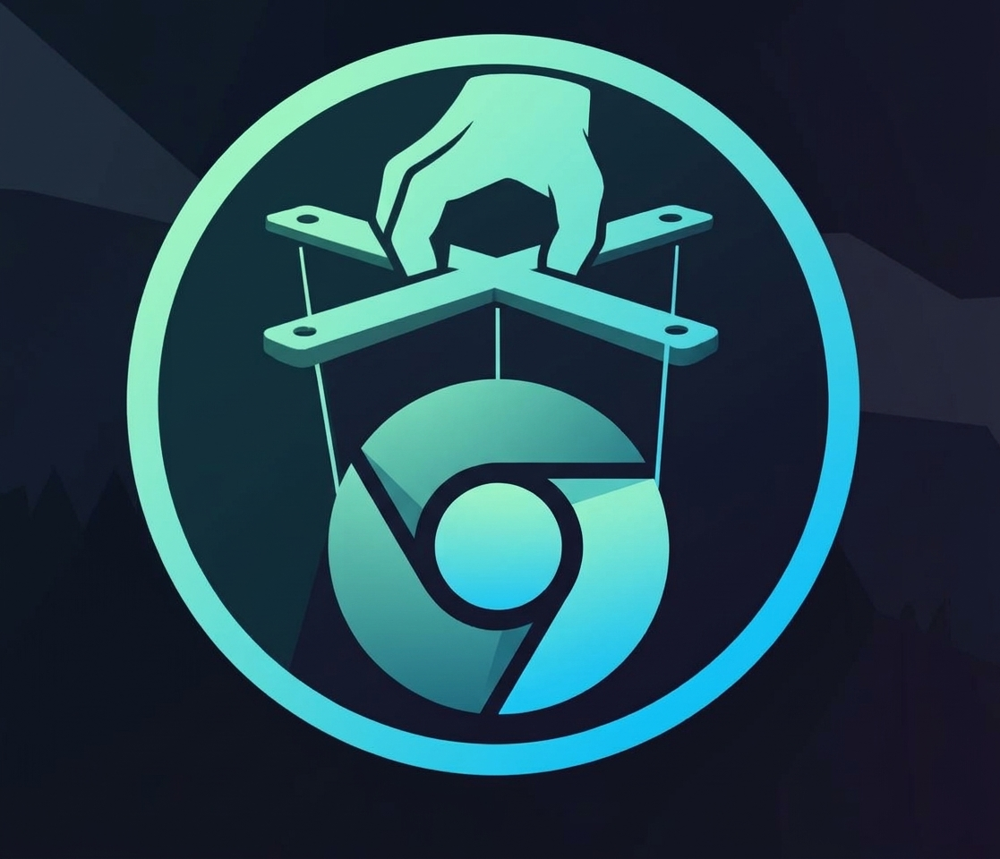

# Chromium Browser



[](LICENSE)
[](docker/default/Dockerfile)
[](https://www.chromium.org)
[](#support)

Docker image with Chromium browser with VNC/noVNC support
for remote access and automation, plus a variant with
[Selkies](https://github.com/selkies-project/selkies) (H.264/WebSocket
streaming) instead of VNC, and a minimal headless variant with
`chrome-headless-shell` for CDP-only automation.

## Table of contents

- [Features](#features)
- [Optimized](#optimized)
- [Quick Start](#quick-start)
- [Configuration](#configuration)
- [Usage](#usage)
- [Ports](#ports)
- [Project structure](#project-structure)
- [License](#license)
- [Support](#support)

## Features

- Chromium with headless support via Xvfb
- Interactive VNC access via noVNC web interface
- Alternative variant: Selkies low-latency H.264 streaming web UI (`docker/selkies`)
- Minimal headless variant: `chrome-headless-shell` with CDP only (`docker/headless`)
- Chrome DevTools Protocol (CDP) for automation
- HTTP proxy support
- Profile persistence via volume
- Log size limits (10 MB x 3 files)

## Optimized

The `docker/optimized` variant (`BROWSER_VARIANT=optimized`) reduces CPU and
RAM consumption compared to `docker/default`:

- Headless mode (`BROWSER_MODE=headless`) - Xvfb, x11vnc and noVNC are not
  started at all; only Chromium runs, with `--headless=new` appended
  automatically
- Background services disabled: component updates, sync, background
  networking, domain reliability, crash reporting (breakpad), client-side
  phishing detection, metrics reporting, extensions, default apps and
  field trial config
- Disabled Chromium features: WebRTC, Translate, MediaRouter,
  OptimizationHints, CalculateNativeWinOcclusion, out-of-process AudioService
- GPU rasterization disabled; rasterization capped at 2 threads
  (`--num-raster-threads=2`)
- Renderer process count capped at 4 (`--renderer-process-limit=4`)
- V8 heap capped at 256 MB (`--js-flags=--max-old-space-size=256`)
- Disk cache capped at 64 MB (`--disk-cache-size=67108864`)
- Autoplay restricted to user gesture (`--autoplay-policy=user-gesture-required`)

## Quick Start

```bash
# Build image
make image-build

# Start container
make compose-up

# Stop container
make compose-down
```

Open noVNC in browser:

```text
http://localhost:3000
```

Or build and run the Selkies variant instead (H.264 over WebSocket,
port 8080):

```bash
make image-build-selkies
BROWSER_VARIANT=selkies make compose-up
```

```text
http://localhost:8080
```

Or build and run the minimal headless variant (CDP only):

```bash
make image-build-headless
BROWSER_VARIANT=headless make compose-up
```

Check CDP:

```bash
curl http://localhost:9222/json/version
```

## Configuration

Create a `.env` file (see `.env.example`):

| Variable            | Description                                       |
| ------------------- | ------------------------------------------------- |
| `BROWSER_VARIANT`   | Browser image version: `default`, `optimized`, `selkies` or `headless` |
| `RESOLUTION`        | Screen resolution                                 |
| `MEM_LIMIT`         | Container memory limit                            |
| `PROXY`             | Proxy URL e.g. `http://host.docker.internal:8138` |
| `CHROME_ARGS_EXTRA` | Extra Chrome flags                                |
| `SELKIES_BASIC_AUTH_PASSWORD` | Selkies web UI login (empty = no login)  |

| Variable            | Default     |
| ------------------- | ----------- |
| `BROWSER_VARIANT`   | `default`   |
| `RESOLUTION`        | `1920x1080` |
| `MEM_LIMIT`         | `100m`      |
| `PROXY`             | empty       |
| `CHROME_ARGS_EXTRA` | empty       |

Set `BROWSER_VARIANT=optimized` in `.env` to run the optimized image.

## Usage

Start with proxy:

```bash
docker compose up -d
```

Run an automation script against CDP:

```bash
curl http://localhost:9222/json/version
```

## Ports

| Port | Service                        |
| ---- | ------------------------------ |
| 9222 | Chrome DevTools Protocol (CDP) |
| 3000 | noVNC web interface            |
| 8080 | Selkies web interface (selkies variant) |

The `headless` variant exposes only CDP (9222/9223 inside the container network).

## Project structure

| Path                             | Description                                             |
| -------------------------------- | ------------------------------------------------------- |
| `docker/default/Dockerfile`      | Base image: Debian bookworm-slim with chromium, VNC     |
| `docker/default/entrypoint.sh`   | Starts Xvfb, VNC, noVNC and Chromium                    |
| `docker/optimized/Dockerfile`    | Resource-optimized image variant                        |
| `docker/optimized/entrypoint.sh` | Launcher for the optimized variant                      |
| `docker/selkies/Dockerfile`      | Selkies variant: chromium + Selkies instead of VNC      |
| `docker/selkies/entrypoint.sh`   | Starts Xvfb, Selkies and Chromium                       |
| `docker/headless/Dockerfile`     | Minimal headless image: `chrome-headless-shell` only    |
| `docker/headless/entrypoint.sh`  | Starts socat and `chrome-headless-shell` CDP server     |
| `docker-compose.yaml`            | Service definition with ports and volumes               |
| `Makefile`                       | Build, run, stop commands                               |
| `.env.example`                   | Environment variables template                          |

## License

MIT

## Support

<p align="center">
  <a href="https://tonviewer.com/UQCcbp-mue-7HTjDNQ_ZrKtg-tUxIFu817APmItjXasiBGP3">
    
  </a>
</p>

<p align="center">
  If this tool helps you, consider buying me a coffee! ☕
</p>
